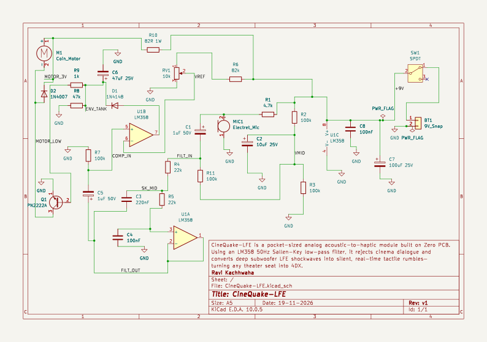
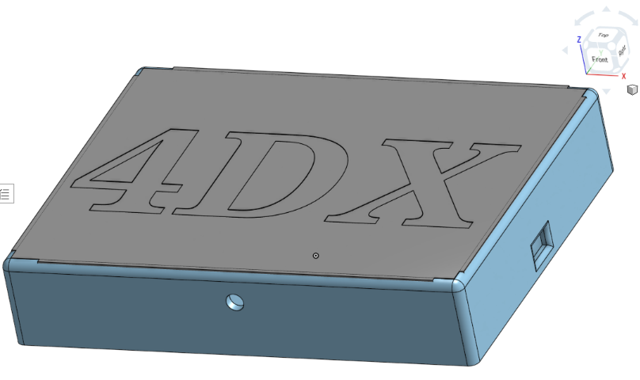

<h1 align="center">
   
  

   
  CineQuake-LFE
   
</h1>
<h3 align="center">
A hand-wired Zero PCB device for real-time tactile rumbles-turning any theater seat into 4DX.
</h3>

Note :- At top cover image I will replace it with the completed Zero PCB after build.

| Front Render | Back Render | 
| --- | --- |
|  |  | 

Note:- The Image will come after build due to this will built on Zero PCB, So when I solder all components on PCB then the image is taken and uploaded to here!!

## Schematics  

Here are the schematic design,

## Features
* **Acoustic LFE Wavefront Sensor**: It have a electret condenser mic to capture deep cinema subwoofer waves.
* **48.8 Hz Sallen-Key Sub-Bass Filter**: I added a LM358N op-amp with 22kOhm resistors and 220nF/100nF capacitors to block dialogue and pass only bass.
* **4.5V Virtual Ground Rail**: It have a symmetric 100kOhm voltage divider bypassed by a 10uF capacitor for ripple-free single-supply op-amp biasing.
* **Precision Auditorium Calibration**: I added a 10kOhm potentiometer with an 82kOhm dropper resistor sweeps trigger sensitivity from 0V to 0.98V.
* **Envelope Pulse-Stretching Engine**: I use a 1N4148 diode and 47uF capacitor shape rapid bass hits into punchy ~140 ms tactile rumbles.
* **Saturated Haptic Driver & Snubber**: I also use a PN2222A transistor which drives a silent 3V coin vibration motor with a 1N4007 flyback protection diode.
* **Thermal-Rated 9V Motor Dropper**: I added An 82Ohm 1W resistor which is to safely steps down 9V battery power to 3.0V at 70mA without overheating.
* **Surge Decoupling & Master Switch**: There is a 100uF bulk reservoir, 100nF bypass capacitor, and SPDT slide switch to ensure clean battery operation.
* **Invisible Operation**: It have zero LEDs for silent, invisible operation inside dark theaters.

### The PCB is Zero PCB with 2 layers (bottom and Top) with dimensions 75.00 x 100.00 mm, made to be easily useable for anyone. 

### PCB Schematic Design files are [here](https://github.com/RaviKachhwaha/CineQuake-LFE/blob/main/hardware) 

## Pinout  

This is a general pinout 

|  | 
| --- | 

Note :- This image will come after building the board over Zero PCB.

## 3D image of case 

This is a 3D view screenshot of case for board.

|  | 
| --- | 

Note :- I not use 3D printing for case's and not added to BOM list due to the cost is very high but if any one want to get this 3D they will get files in 3D files folder.

3D design files are on Onshape [here](https://cad.onshape.com/documents/4bba22cec4122c4bcc3083e4/w/36bf6bd5371a5c47f1820a45/e/f9805e91552ef832d796fe02?renderMode=0&uiState=6b002dea16bcd8ce7b74e065)

(Credits to KiCad EDA for KiCad 10, Texas Instruments for the LM358N dual op-amp, onsemi for the PN2222A NPN transistor, and Hack Club for funding to make this possible.)

## Why was it made?  

While watching movies in normal theaters many time, I realised it doesn't have 4DX, and felling quality and I couldn't got 4DX felling, unfortunately I had to think to go to a 4DX theater but I seen there is no 4DX theater near me or in my city, but now I designed one device with many simplicity's and have power to give me 4DX felling and also give me the top most need of near by 4DX felling.
It will also build my soldering skills more best and perfect.

## How you can get one for yourself? 

That is pretty easy, you have all the files you will need in the hardware folder, order the compoents and BOM list items and solder them by your self on Zero PCB and BINGO! You will have it to use for any movie  in any theaters you want!  

## How do you use it?  
You can use it as any normal device in you pocket but first you want to connect the board input power to 9V Rechargeable battery and then turn on via the switch and set the potentiometer according to your need and you are good to go!
It doedn't require any firmware.

## BOM  
|Name|Purpose          |Quantity|Total Cost (USD)|Link               |Distributor|
|----|-----------------|--------|----------------|-------------------|-----------|
|General Purpose Printed Mini Zero PCB Board |To place every component over it and hand solder them using soldering Iron|1       |1.85           |[Zero PCB](https://www.amazon.in/dp/B0CJJJLB2P)|Amazon India     |
|Components|Needed components to place over Zero PCB and build the working board|1       |36.33           |[Amazon India](https://www.amazon.in)|Amazon India     |
|LED Rope Light 40 Meter |The board is build for this LED lighting so this is needed to test the board is working or not|1       |14.10          |[LED Rope Light](https://www.amazon.in/gp/product/B0B9YMGJF6)|Amazon India     |
|LED String Light 90 Meter |I will make total 2 board's so to check both and run both boards at same time this second LED is needed|1       |8.50          |[LED String Light](https://www.amazon.in/gp/product/B0DD3PFZKJ)|Amazon India     |
|Soldering Wire and Flux |To solder the components over the board and flux to make soldering perfect and strong|1       |4.26           |[Soldering Wire with Flux](https://www.amazon.in/VMTRONIX-Solder-Welfix-Soldering-Rosin-Rich/dp/B0D7ZB2H93)| Amazon India     |
|Wire|Wire is needed to joint the board input to wall plug and the output to the LED input|1       |6.81           |[Wire](https://www.amazon.in/gp/product/B0F2N62N52)| Amazon India     |
|MDF Board |MDF Board is needed to make it's case's|1       |2.65           |[MDF Board](https://www.amazon.in/dp/B09PLC82L1)| Amazon India     |
|Spray Paint (Black) |This is needed to make it's MDF case's high quality and fully ready and coted for long life of case and this is for Base|1       |2.50           |[Spray Paint Black](https://www.amazon.in/gp/product/B08G54WH1J)| Amazon India     |
|Spray Paint (White) |This is needed to make it's MDF case's high quality and fully ready and coted for long life of case and this is for Lid|1       |2.00           |[Spray Paint White](https://www.amazon.in/gp/product/B08BWRFBZD)| Amazon India     |
| | | Total | 79.00 |

LCSC & DigiKey BOM for the components on board is [here](https://github.com/RaviKachhwaha/LUMISPARK-300X/blob/main/components_bom.csv)

!!Thanks to ALL!!
